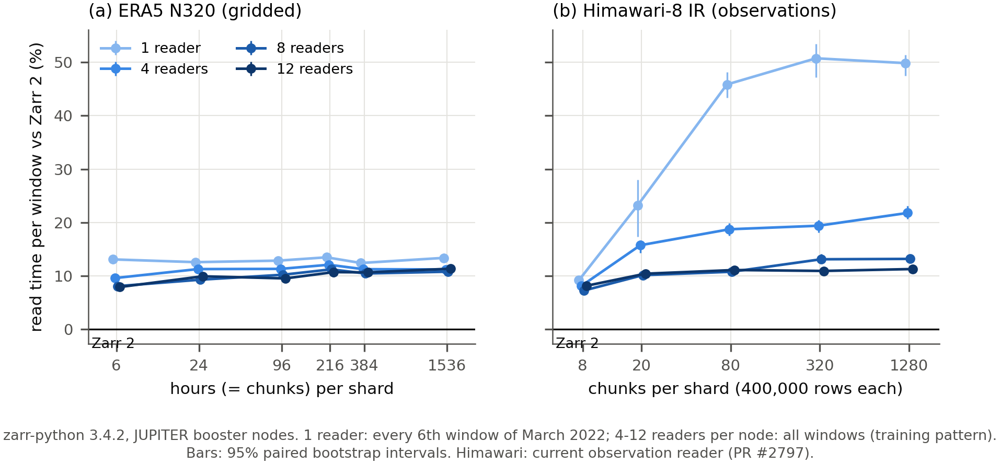
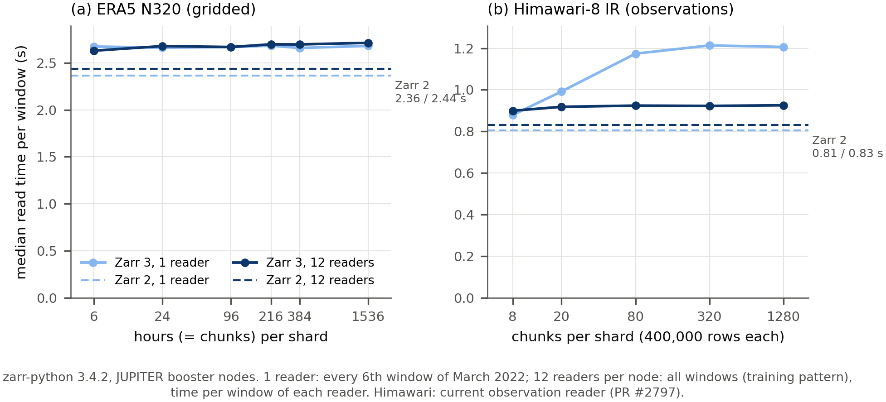
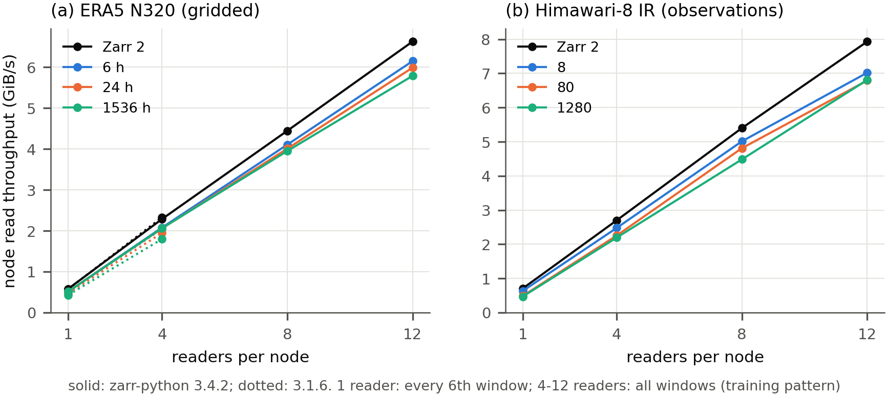

# Zarr 2 vs sharded Zarr 3 with zarr-python 3.4.2: results

*2026-11-19. Full notes: `zarr-sharding-experiments.md` (Sections 8.7 and 8.9).*

## Setup

- **Change:** zarr-python 3.1.6 → **3.4.2**.
- **Readers:** WeatherGenerator `DataReaderAnemoi` (ERA5) and the current `DataReaderObs` (Himawari; PR #2797, one read of all columns per window).
- **Benchmark:** 6 h windows of March 2022, shuffled, median time per window. Every window's checksum matches Zarr 2.
- **Where:** JUPITER booster nodes, one node per run type.
- **Run types:** 1, 4, 8 and 12 readers per node reading all windows (= training pattern).

## Results (compute nodes, % vs Zarr 2, negative = faster)

### ERA5 N320

Zarr 2: 2.37 s per window (1 reader).

| Shard size | 1 reader | 1, serial | 4, all | 8, all | 12, all |
| --- | --- | --- | --- | --- | --- |
| 6 h | +13% | +1% | +10% | +8% | +8% |
| 24–1536 h | +12–13% | 0–1% | +11–12% | +9–11% | +10–11% |

### Himawari-8 IR

Zarr 2: 0.81 s per window (1 reader).

| Chunks per shard | 1 reader | 1, serial | 4, all | 8, all | 12, all |
| --- | --- | --- | --- | --- | --- |
| 8 | **+9%** | +6% | +8% | +7% | **+8%** |
| 20 | +23% | +4% | +16% | +10% | +10% |
| 80 | +46% | +5% | +19% | +11% | +11% |
| 320–1280 | +50–51% | +17–18% | +19–22% | +13% | +11% |

### Compared with zarr 3.1.6

1 reader, seconds per window; Himawari 3.1.6 with the earlier reader.

| | Zarr 2 | smallest shards | largest shards |
| --- | --- | --- | --- |
| ERA5, 3.1.6 → 3.4.2 | 2.40 → 2.37 | 2.71 → 2.67 (6 h) | 3.18 → 2.68 (1536 h) |
| Himawari, 3.1.6 → 3.4.2 | 2.05 → 0.81 | 3.97 → 0.88 (8) | 6.74 → 1.21 (1280) |

## Findings

1. **ERA5:** +8–14% for every shard size (3.1.6: +11–30%). Shard size no longer matters.
2. **Himawari:** row-wise shards cost **+8–11% in the training pattern** (12 readers per node) for every shard size, the same as ERA5. With 1 reader, small shards are best (+9% for 8 chunks per shard).
3. **More readers per node narrow the gap** for all layouts.

## Recommendation

- Use **zarr-python ≥ 3.4.2** (WeatherGenerator updated in the working copy, not committed yet).
- **ERA5:** large shards (384–1536 h → 6–23 files per year instead of 8,760); cost ~+11%.
- **Observations:** keep the **row-wise chunks** (no code change) and shard them; **80 chunks per shard** (~1 day per file, 80× fewer files) costs ~+11% in the training pattern. Smaller shards (8–20) if single-reader speed matters.

## Caveats

- One run per configuration, one month. Repeats on other nodes/days still needed.
- All runs of a series ran at the same time on the same file system.

## Figures

**Chunks per shard vs slowdown.** One line per number of readers per node; 0 = Zarr 2. ERA5 is flat (shard size does not matter). Himawari with 1 reader gets slower up to 80 chunks per shard and then levels off (+9% → +46% → +50%); with 8–12 readers every shard size costs ~+8–13%.

**Chunks per shard vs read time (s).** Same data in seconds; dashed = Zarr 2. With 12 readers per node, Himawari stays at ~0.90–0.93 s per window for every shard size (Zarr 2: 0.83 s).

**Node throughput vs readers per node.** Data delivered by the whole node per second (all readers together, decompressed). All formats scale almost linearly up to 12 readers (12 readers ≈ 12× one reader), so storage is not the bottleneck; sharded Zarr 3 stays ~10% below Zarr 2 at every reader count. Solid: zarr 3.4.2; dotted: 3.1.6.

